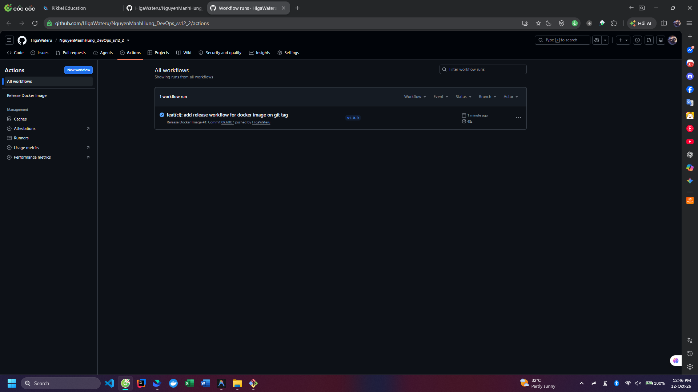
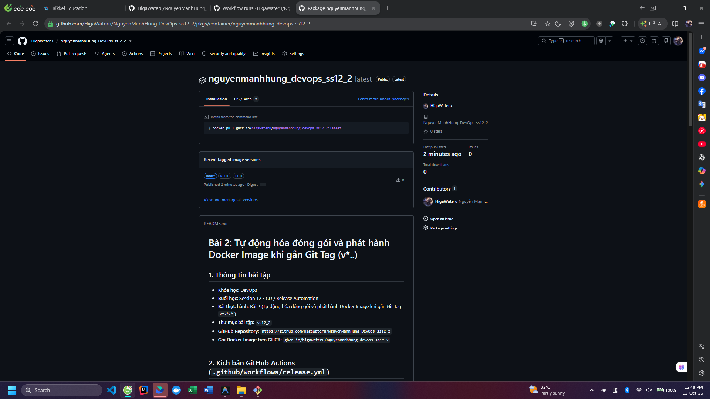

# Bài 2: Tự động hóa đóng gói và phát hành Docker Image khi gắn Git Tag (v*..)

## 1. Thông tin bài tập
- **Khóa học:** DevOps
- **Buổi học:** Session 12 - CD / Release Automation
- **Bài thực hành:** Bài 2 (Tự động hóa đóng gói và phát hành Docker Image khi gắn Git Tag `v*.*.*`)
- **Thư mục bài tập:** `ss12_2`
- **GitHub Repository:** `https://github.com/HigaWateru/NguyenManhHung_DevOps_ss12_2`
- **Gói Docker Image trên GHCR:** `ghcr.io/higawateru/nguyenmanhhung_devops_ss12_2`

---

## 2. Kịch bản GitHub Actions (`.github/workflows/release.yml`)

```yaml
name: Release Docker Image

on:
  push:
    tags:
      - 'v*.*.*'
  workflow_dispatch:

# Cấp quyền đọc mã nguồn và ghi packages vào GitHub Container Registry (GHCR)
permissions:
  contents: read
  packages: write

jobs:
  release-image:
    name: Build & Release Docker Image
    runs-on: ubuntu-latest

    steps:
      # 1. Checkout mã nguồn
      - name: Checkout code
        uses: actions/checkout@v5

      # 2. Chuẩn hóa tên repository thành chữ thường (bắt buộc cho GHCR)
      - name: Set lowercase repository name for GHCR
        run: |
          echo "IMAGE_NAME=ghcr.io/${GITHUB_REPOSITORY,,}" >> $GITHUB_ENV

      # 3. Đăng nhập vào GHCR với GITHUB_TOKEN
      - name: Log in to GitHub Container Registry (GHCR)
        uses: docker/login-action@v3
        with:
          registry: ghcr.io
          username: ${{ github.actor }}
          password: ${{ secrets.GITHUB_TOKEN }}

      # 4. Trích xuất tag & metadata từ Git Tag (v*.*.*)
      - name: Extract Docker metadata (Tags & Labels)
        id: meta
        uses: docker/metadata-action@v5
        with:
          images: ${{ env.IMAGE_NAME }}
          tags: |
            type=ref,event=tag
            type=semver,pattern={{version}}
            type=semver,pattern=v{{version}}

      # 5. Thiết lập Docker Buildx
      - name: Set up Docker Buildx
        uses: docker/setup-buildx-action@v3

      # 6. Đóng gói và push Docker Image lên GHCR
      - name: Build and push Docker Image
        uses: docker/build-push-action@v5
        with:
          context: .
          push: true
          tags: ${{ steps.meta.outputs.tags }}
          labels: ${{ steps.meta.outputs.labels }}
```

---

## 3. Giải thích các thành phần kỹ thuật

1. **Sự kiện kích hoạt (`on.push.tags: ['v*.*.*']`):**
   - Workflow chỉ được kích hoạt tự động khi lập trình viên gắn Git Tag có định dạng Semantic Versioning như `v1.0.0`, `v1.0.1`, `v2.0.0`... và push lên GitHub.

2. **Quyền truy cập (`permissions: packages: write`):**
   - GitHub Container Registry (GHCR) yêu cầu quyền `packages: write` cho `GITHUB_TOKEN` để workflow có thể tải (push) Docker Image lên Registry.

3. **Chuẩn hóa chữ thường (`${GITHUB_REPOSITORY,,}`):**
   - Chuẩn Docker Registry (bao gồm GHCR) không chấp nhận ký tự in hoa trong tên repository/image. Biến đổi `${GITHUB_REPOSITORY,,}` chuyển toàn bộ tên repository về chữ thường giúp tránh lỗi `invalid reference format`.

4. **Trích xuất Tag tự động (`docker/metadata-action@v5`):**
   - Tự động trích xuất số phiên bản từ Git Tag (ví dụ: `v1.0.0` sinh ra cả tag `:v1.0.0` và `:1.0.0`).
   - Tự động gán các nhãn OCI labels tiêu chuẩn (commit SHA, ngày build, git ref) vào image.

5. **Đóng gói đa tầng (`Multi-stage Dockerfile`):**
   - Tách biệt rõ ràng tầng Build (Gradle 8.5) và tầng Runtime (JRE 17 Alpine nhẹ ~140MB), giúp image thành phẩm an toàn, gọn gàng và không phụ thuộc vào môi trường máy runner.

---

## 4. Hướng dẫn các bước thực hiện và kiểm tra

### Bước 1: Khởi tạo và đẩy mã nguồn lên nhánh chính
```bash
git add .
git commit -m "feat: setup release workflow with docker metadata-action"
git branch -M main
git push -u origin main
```

### Bước 2: Gắn Git Tag phát hành và đẩy lên GitHub
```bash
git tag v1.0.0
git push origin v1.0.0
```

### Bước 3: Kiểm tra luồng chạy và gói Container Image
1. **Kiểm tra tab Actions:**
   - Truy cập: `https://github.com/HigaWateru/NguyenManhHung_DevOps_ss12_2/actions`
   - Quan sát workflow **Release Docker Image** được kích hoạt bởi tag `v1.0.0` và chạy thành công (tất cả các bước xanh).
2. **Kiểm tra mục GitHub Packages:**
   - Truy cập: `https://github.com/HigaWateru/NguyenManhHung_DevOps_ss12_2/pkgs/container/nguyenmanhhung_devops_ss12_2`
   - Hoặc xem danh sách Packages của tài khoản: `https://github.com/HigaWateru?tab=packages`
   - Gói Docker Image xuất hiện với phiên bản tag `v1.0.0` (và `1.0.0`).

---

## 5. Hình ảnh minh chứng nộp bài

### Ảnh 1: Workflow `release.yml` chạy thành công trên tab Actions


### Ảnh 2: Docker Image `v1.0.0` xuất hiện trên GitHub Packages

